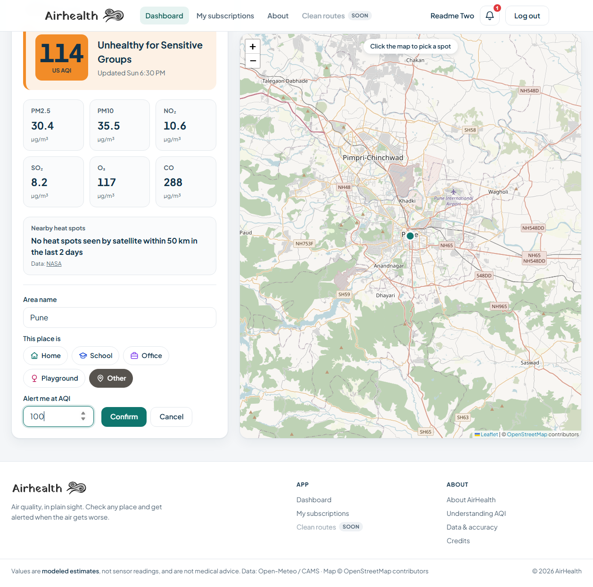
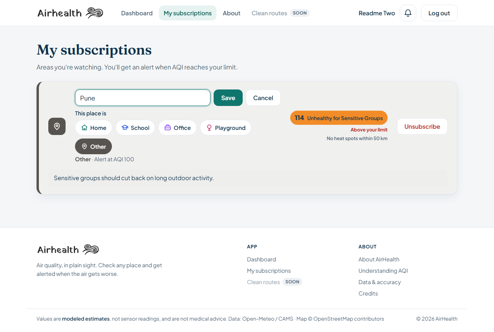
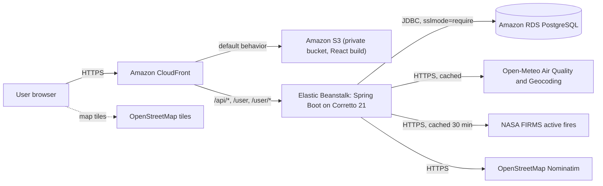
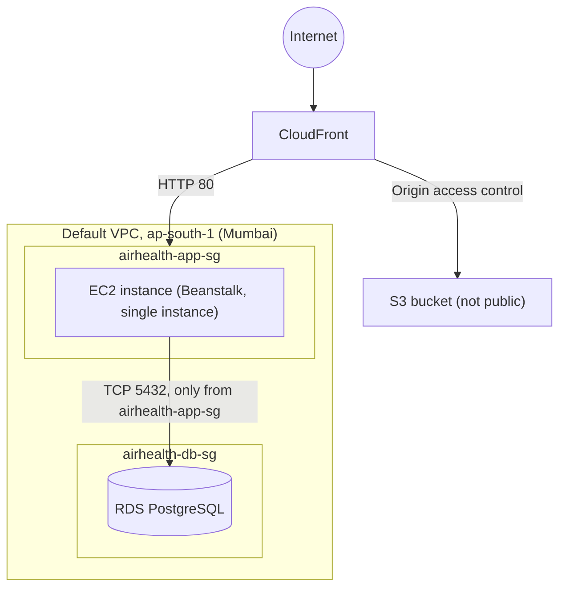
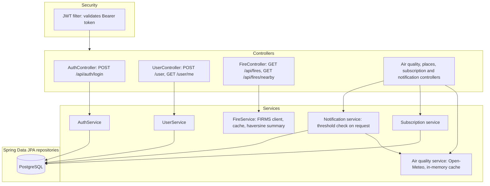
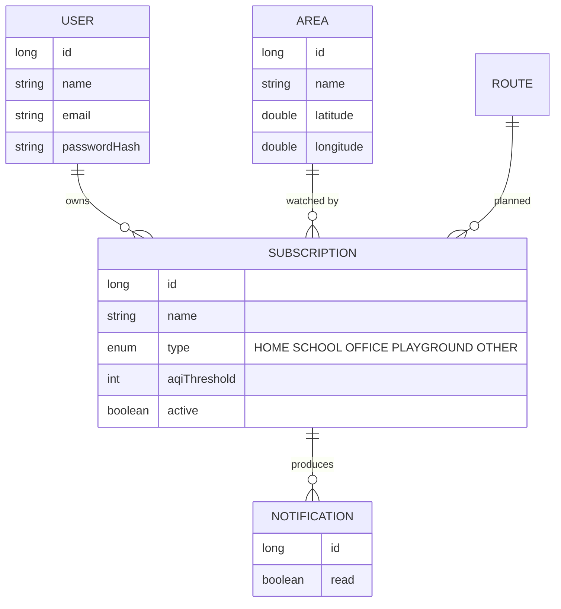
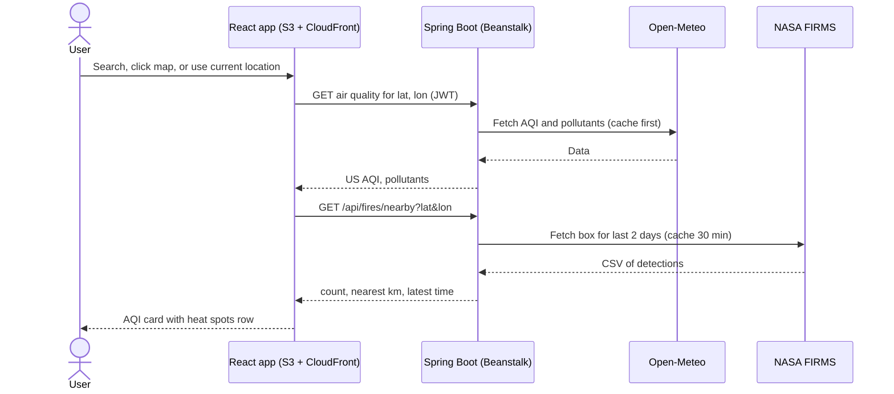
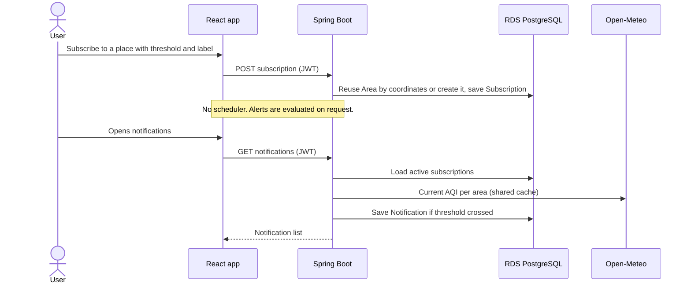

# Airhealth

Know the air before you step out. Airhealth lets you check the air quality of any place on a map, see nearby satellite-detected heat spots, and subscribe to areas so you get notified when the air gets bad.

## Live Demo

https://d2m0b3oibu3wv6.cloudfront.net (AWS: S3 + CloudFront + Elastic Beanstalk + RDS)

## Screenshots

> Captured from the live demo https://d2m0b3oibu3wv6.cloudfront.net (October 2026).

### Landing page


### About / AQI guide


### Sign up


### Log in


### Dashboard - search and map


### Subscribing a searched place



### My subscriptions and notifications


### Editing a subscription



## Features

- **AQI map:** look up air quality for any place, by search, map click, or your current location
- **Pollutants:** PM2.5, PM10, NO2, SO2, O3 and CO with a plain-language health meaning
- **Nearby heat spots:** NASA FIRMS satellite detections within 50 km of a place
- **Subscriptions:** subscribe to an area with an AQI threshold
- **In-app notifications:** get alerted when your threshold is crossed
- **Health info:** a page explaining how air quality affects health
- **Auth:** email + password login with JWT
- No personal details are stored.

## Tech Stack

| Layer | Tech |
| --- | --- |
| Backend | Java 21, Spring Boot, Spring Data JPA, Spring Security, JJWT |
| Database | PostgreSQL |
| Frontend | React (JavaScript), Leaflet |
| Data | Open-Meteo Air Quality + Geocoding, NASA FIRMS (active fires), OpenStreetMap Nominatim |
| Hosting | AWS: S3 + CloudFront (frontend), Elastic Beanstalk on Corretto 21 (backend), RDS PostgreSQL |

## How It Works

- Air quality data (US AQI and pollutants) is fetched from Open-Meteo and cached in memory. No air data is stored in the database.
- Fire detections are fetched from NASA FIRMS on request and cached for 30 minutes. They are satellite-detected heat sources and may include burning other than crop residue. Satellites can miss fires under cloud or between passes.
- Subscription thresholds are checked when the frontend fetches notifications.
- The React build is hosted in a private S3 bucket behind CloudFront. CloudFront routes `/api/*`, `/user` and `/user/*` to the Elastic Beanstalk backend, and sends 403/404 responses to `/index.html` so client-side routes work on refresh.
- When the app is run as a single jar (locally or in Docker), the React build is served from the Spring Boot jar's static folder, and `SpaController` forwards client-side routes (`/about`, `/login`, `/app`, ...) to `index.html`.

## Architecture

Airhealth shows air quality for any place on a map, adds nearby NASA satellite heat spots, and sends in-app alerts when a subscribed area crosses the user's AQI threshold. No personal details are stored.

### 1. System overview (AWS deployment)



### 2. Network and security



### 3. Backend layers



### 4. Data model



Air quality and fire data are never stored. They are fetched on request and cached in memory.

### 5. Key flows

**Check air quality and nearby heat spots**



**Subscribe and get alerted**



### 6. Design decisions

| Decision | Reason |
| --- | --- |
| Frontend in S3 behind CloudFront, backend only on Beanstalk | HTTPS on the default CloudFront domain, one origin for the browser, no CORS setup, and the browser location button needs HTTPS |
| Own JWT login instead of Cognito | Keeps the project independent of one AWS service |
| One air data source (Open-Meteo), nothing stored | Data covers the whole world, cannot be stored for every location, and stays simple |
| Subscriptions are by place, not person | The app never knows who a user is protecting, for example a child, so no personal details are stored |
| Alerts checked on request, no scheduler | Simplest working version for the deadline |
| Fires fetched on request, cached 30 minutes | Avoids one FIRMS call per user, and FIRMS data refreshes every few hours |
| Fire endpoint stays behind JWT | Same security rules as the rest of the API |
| RDS reachable only from the app security group | Database is not public |

### 7. CloudFront routing

| Path pattern | Origin | Notes |
| --- | --- | --- |
| `/api/*` | Beanstalk (HTTP only, port 80) | CachingDisabled, AllViewerExceptHostHeader, all methods |
| `/user/*` | Beanstalk | Same settings |
| `/user` | Beanstalk | Needed separately, because `/user/*` does not match the bare path (signup is `POST /user`) |
| Default | S3 (origin access control) | GET and HEAD, CachingOptimized |
| Error pages | 403 and 404 return `/index.html` with 200 | Makes React routes like `/app` work on refresh |

### 8. Configuration

Environment variables set as Elastic Beanstalk properties: `DB_URL` (with `?sslmode=require`), `DB_USERNAME`, `POSTGRESQL_PASSWORD_AIRHEALTH`, `JWT_SECRET_AIRHEALTH`, `FIRMS_KEY`, `PORT=5000`.

### 9. Known limits and planned work

- Alerts run only when notifications are fetched. Planned: scheduled checks (for example Amazon EventBridge).
- Route suggestions and route subscriptions are not built. Open-Meteo data is a coarse grid, so two routes in one city would score almost the same.
- Heat spots are satellite-detected heat sources, not confirmed crop burning. Clouds and satellite pass timing can hide fires.

## Running Locally

### Prerequisites

- Java 21
- Node.js 20.19+ (required by Vite 8)
- PostgreSQL

### Backend

1. Create a PostgreSQL database.
2. Set the [environment variables](#environment-variables) below.
3. Run:

```bash
cd backend
./mvnw spring-boot:run
```

The API runs on http://localhost:8080.

### Frontend

```bash
cd frontend
npm install
npm run dev
```

Open http://localhost:5173. The Vite dev server proxies `/api` and `/user` to the backend on port 8080.

### Run with Docker

```bash
docker build -t airhealth .
docker run -p 8080:8080 \
  -e DB_URL=<jdbc-url> \
  -e DB_USERNAME=<user> \
  -e POSTGRESQL_PASSWORD_AIRHEALTH=<password> \
  -e JWT_SECRET_AIRHEALTH=<secret> \
  -e FIRMS_KEY=<nasa-firms-map-key> \
  airhealth
```

Then open http://localhost:8080.

## Environment Variables

| Variable | Description | Default |
| --- | --- | --- |
| `DB_URL` | PostgreSQL JDBC URL | `jdbc:postgresql://localhost:5432/airhealth` |
| `DB_USERNAME` | Database username | `airhealth` |
| `POSTGRESQL_PASSWORD_AIRHEALTH` | Database password | required |
| `JWT_SECRET_AIRHEALTH` | Secret used to sign JWTs | required |
| `FIRMS_KEY` | NASA FIRMS map key (for heat spots) | required for heat spots |
| `PORT` | HTTP port (5000 on Elastic Beanstalk) | `8080` |
| `NOMINATIM_USER_AGENT` | User-Agent sent to Nominatim, per its usage policy | `AirHealth/0.1 (hackathon project)` |

On AWS, set these as Elastic Beanstalk environment properties. Use `?sslmode=require` on the RDS JDBC URL.

## Tests

The backend has 137 tests (JUnit 5, Mockito, Spring Security Test):

- **Controller tests** (`@WebMvcTest`): request/response shape, bad-request cases, and auth rules for each endpoint
- **Service tests:** auth, JWT, users, subscriptions, notifications, air quality, places, and fires, with repositories and clients mocked
- **Client tests:** the Open-Meteo geocoding and Nominatim reverse-geocoding clients
- **`contextLoads`:** starts the full application, so it needs a reachable database and the environment variables above

```bash
cd backend
./mvnw test
```

Frontend lint:

```bash
cd frontend
npm run lint
```

The Docker build skips tests (`-DskipTests`) because the build container has no database or secrets, so run them locally before deploying.

## Planned

- Less-polluted route suggestions and route subscriptions
- Scheduled alerts

## Credits

- Air quality: [Open-Meteo Air Quality API](https://open-meteo.com/) (CC BY 4.0). Contains modified Copernicus Atmosphere Monitoring Service information.
- Place search: Open-Meteo Geocoding API, based on GeoNames data.
- Active fire data: NASA FIRMS (VIIRS).
- Map tiles and area names: © OpenStreetMap contributors (ODbL), looked up with Nominatim.
- Map display: Leaflet.
- Fonts: Fraunces and Plus Jakarta Sans (SIL Open Font License), via Fontsource.
- Built with Spring Boot, JJWT, React, and Vite.

## License

[MIT](LICENSE)

## Author

Atharv Chavan ([@Atharv3221](https://github.com/Atharv3221))
Lidiya ([@lidiya0700](https://github.com/lidiya0700))
